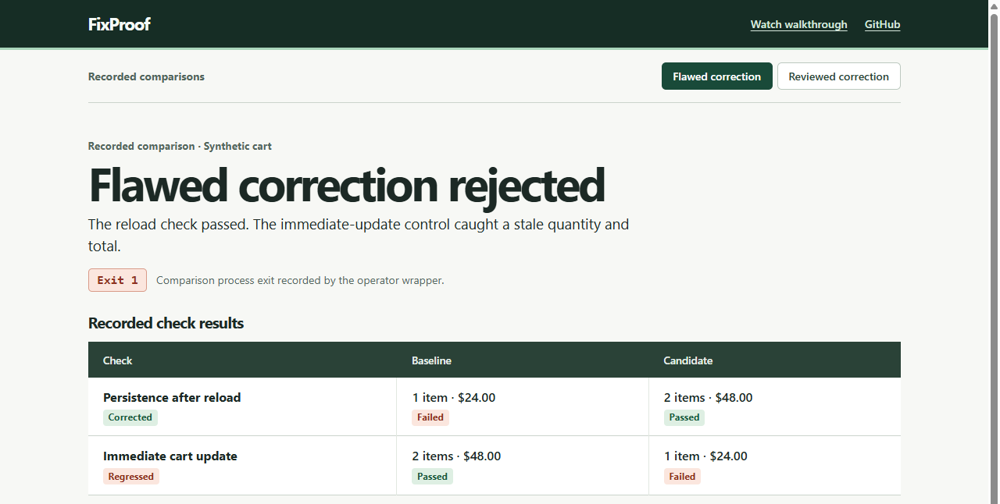

# FixProof

FixProof uses Kane CLI to check whether a proposed bug fix works **and whether it breaks behavior that used to pass**. It runs the same browser actions on a baseline and a candidate and saves the observations for review.

**[Open the recorded demo](https://elouahid.github.io/fixproof-kane/)** · [Watch the 3:07 walkthrough](https://youtu.be/SW1Dju1sNsQ) · [Inspect the evidence](evidence/control-regression/README.md) · [Run locally](#view-the-saved-runs)

**An independently reported bug.** On TodoMVC’s JavaScript ES5 app, clicking “Mark all” after reopening one task left **2 items active**. With a one-line local correction, the same clicks left **0**. The two-click control showed **1 item left** on both builds. One complete Kane comparison recorded all four results and exited **0**. [Open the saved TodoMVC evidence](evidence/todomvc/README.md) · [Read the upstream issue](https://github.com/tastejs/todomvc/issues/2310)

In the synthetic cart demo, both candidates saved the new quantity. The difference was what the customer saw immediately after clicking **Increase**. Each row is a separate run of the same case. **Select a quantity and total to see the original browser screenshot.**

| Candidate and saved report | After reload | Immediately after the click | Recorded comparison exit |
| --- | --- | --- | --- |
| [Deliberately flawed correction](evidence/control-regression/flawed.json) | [2 items · $48][flawed-reload] · passed | **[1 item · $24][flawed-immediate] · regressed** | **[1 · View rejection](https://elouahid.github.io/fixproof-kane/?run=flawed#evidence-2)** |
| [Reviewed correction](evidence/control-regression/reviewed.json) | [2 items · $48][reviewed-reload] · passed | **[2 items · $48][reviewed-immediate] · passed** | **[0 · View retest](https://elouahid.github.io/fixproof-kane/?run=reviewed#evidence-2)** |

[flawed-reload]: evidence/control-regression/attempts/4c562a74-0669-4e0d-a4ad-e2eb73693f8a/candidate-refresh.jpg
[flawed-immediate]: evidence/control-regression/attempts/4c562a74-0669-4e0d-a4ad-e2eb73693f8a/candidate-live-total.jpg
[reviewed-reload]: evidence/control-regression/attempts/0a44432b-c0fd-4179-a377-a2f3ee894d47/candidate-refresh.jpg
[reviewed-immediate]: evidence/control-regression/attempts/0a44432b-c0fd-4179-a377-a2f3ee894d47/candidate-live-total.jpg

[](https://elouahid.github.io/fixproof-kane/?run=flawed)

In the rejected run, the [baseline already showed 2 items and $48 immediately](evidence/control-regression/attempts/4c562a74-0669-4e0d-a4ad-e2eb73693f8a/baseline-live-total.jpg). The operator captured each comparison's process exit. Four other attempts ended incomplete and remain available alongside the two complete reports. [Run manifest](evidence/control-regression/manifest.json) · [All six attempts](evidence/control-regression/README.md#every-attempt-is-retained) · [Repair brief for the rejected fix](evidence/control-regression/repair-brief.md)

## View the saved runs

From the repository root, start the viewer with **Node.js 20 or later**. Viewing saved results requires no account, Kane installation, or credits.

```sh
node app/server.mjs
```

Open the [flawed correction](http://127.0.0.1:8741/?run=flawed) or the [reviewed correction](http://127.0.0.1:8741/?run=reviewed). Both are available on the same server. The home page opens the flawed comparison. The viewer shows the recorded run ID, readouts, and tested build fingerprints. The recorded exit is unavailable when the viewer cannot verify its source.

The local server also serves a [current baseline cart](http://127.0.0.1:8741/baseline/) and a [current reviewed candidate cart](http://127.0.0.1:8741/candidate/). These interactive pages use the JavaScript in this checkout. Inspect the [deliberately flawed source snapshot](evidence/control-regression/deliberately-flawed-candidate.js) to see the version that omitted the immediate redraw.

To inspect a different saved report, stop the server and restart it with its path. For example, this opens an earlier comparison in which the evidence was incomplete.

```sh
node app/server.mjs --report evidence/incomplete.json
```

### Host the static viewer

The public demo serves the two recorded comparisons from the `gh-pages` branch. To build a copy from the same viewer and saved evidence, run the export from the repository root.

```sh
node scripts/export-preview.mjs
```

Serve the contents of `dist/preview/` with a static web server. To use the built-in Python server, run the following command.

```sh
python -m http.server 8742 --bind 127.0.0.1 --directory dist/preview
```

Open [the static preview](http://127.0.0.1:8742/). It includes the recorded screenshots and build fingerprints. The interactive cart applications are available through the Node server.

## Run a new Kane comparison

Live verification drives Chrome and uses a TestMu AI account with Kane credits. The documented integration used Kane CLI 0.10.4 on Windows. [Kane CLI quickstart](https://www.testmuai.com/docs/kane-cli-quickstart)

```sh
npm install --global @testmuai/kane-cli@0.10.4
kane-cli login --oauth
```

Keep `node app/server.mjs` running on the default port. In a second terminal, run the frozen case against the **currently served builds**.

```sh
node compare.mjs cases/cart.json --candidate-source app/candidate.js
```

Open `report.md` or `report.json` in the output directory printed by the command. Exit `0` means all candidate checks passed with complete comparisons. Exit `1` means a candidate check failed with evidence. Exit `2` means a comparison is incomplete. A baseline-only run (`--baseline`) has its own exit convention and can exit `0` after conclusively reproducing a bug.

Keep generated `.fixproof/` directories private. Raw Kane packs can contain account metadata and application network logs. The checked-in evidence includes sanitized reports and selected synthetic-cart screenshots.

## Give an observed failure to a coding agent

Choose the exact case, saved report, and candidate source files. The repair brief includes expected actions, observed values, evidence digests, and the command to run the same case again. Source hashes let a reviewer check whether the file in hand matches the one captured during the run.

```sh
node repair-brief.mjs --report ".fixproof/runs/<run-id>/report.json" --case cases/cart.json --source app/candidate.js
```

Review the proposed edit before rerunning the case and controls. FixProof applies no automatic changes. The flawed edit in the demonstration was constructed deliberately. An earlier, separate handoff records Meta's actual proposal and its reviewed retest. [Recorded repair handoff](evidence/repair-brief/README.md)

## Use your own case

Copy [the cart case](cases/cart.json) and set both URLs and the HTTP header that identifies each build. Both deployments must answer `HEAD` and keep a stable build fingerprint during the comparison. Supply the expected visible values, a primary check, and one to three controls.

Case schema version 2 supports ordered button clicks with an HTML ID and accessible name, followed by an optional same-page reload. Use the literal placeholder `${appUrl}` for the tested URL. Missing or unconfirmed actions leave a check incomplete. The [earlier verification](VERIFICATION.md) shows why action order matters and documents the original baseline and historical case.
